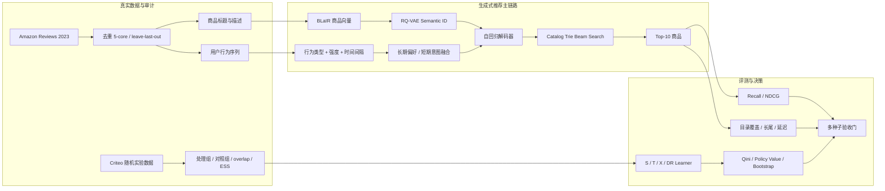
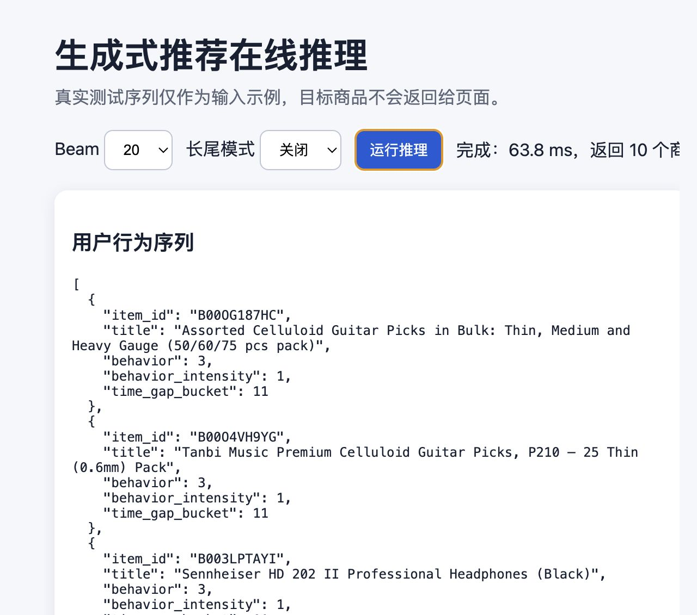

# Reasoning-Enhanced Generative Recommendation for E-commerce

一个面向真实电商序列的生成式推荐项目：将商品文本压缩为离散 Semantic ID，使用行为感知
Transformer 建模用户兴趣，自回归生成候选商品，并通过长尾重排与因果资格门禁评估部署边界。

`Amazon Reviews 2023` · `BLaIR` · `RQ-VAE` · `Transformer` · `Trie Beam Search` ·
`SASRec` · `Uplift Modeling` · `PyTorch`

## 项目概览

项目不是单次训练脚本，而是一套可审计的离线推荐实验系统，覆盖：

- 真实数据下载、校验、时间切分和 SHA-256 追踪；
- 商品语义离散化、序列生成、受约束解码与 Top-K 评测；
- 行为强度、时间衰减、长期/短期偏好融合及机制消融；
- 长尾分层、候选召回、目录覆盖、延迟与 Pareto 分析；
- 三随机种子、Student-t 区间、McNemar 与 bootstrap；
- 候选级因果数据门禁、cross-fitted uplift learner 与离线策略评估。

最终默认推荐方案为 `token_loss_010 + Beam-20/Top-10`。增强方案只有在同时满足总体准确率、
长尾命中和统计区间门槛时才允许升级；未通过门槛的实验保留为可复现负结果。

## 系统架构



## 数据与规模

| 数据 | 用途 | 规模与状态 |
|---|---|---|
| Amazon Reviews 2023 / Musical Instruments | V1/V2 主推荐实验 | 339,519 Train、57,439 Validation、57,439 Test；24,587 个商品 |
| Amazon Reviews 2023 / Industrial & Scientific | 跨品类验证 | 三种子 V2/SASRec 对照已完成 |
| All Beauty / Toys / Sports | 数据与向量准备 | 真实数据审计和 BLaIR 编码完成，未报告模型效果 |
| Criteo Uplift | V3-lite 因果辅助验证 | 全量审计 13,979,592 行；正式实验均匀抽取 1,000,000 行 |

所有正式推荐结果使用真实数据，参数只在 Validation 上选择；Test 不参与选参。

## 核心结果

### 1. 默认推荐方案

Amazon Reviews 2023 / Musical Instruments，seed 2026/2027/2028，完整 Test。下表为三种子
均值，指标单位为百分比。

| 模型 | Recall@5 | NDCG@5 | Recall@10 | NDCG@10 |
|---|---:|---:|---:|---:|
| SASRec | 2.4763 | 1.5891 | 3.9955 | 2.0767 |
| 原 V2 | 2.4890 | 1.6159 | 4.0002 | **2.1012** |
| **V2 + token loss 0.10（默认）** | **2.5186** | **1.6166** | **4.0019** | 2.0927 |

默认方案的 Recall@10 95% Student-t 区间为 `[3.6935%, 4.3103%]`。它与 SASRec 的区间
重叠，因此正确结论是“生成链路达到同量级效果并形成完整工程闭环”，不是“稳定显著优于
SASRec”。

### 2. RQ-VAE 码本与受约束生成

- 24,587 个 768 维 BLaIR 商品向量；
- 3 层 × 256 codes，K-means 初始化、EMA 更新、50 epochs；
- 三层码本利用率分别为 `90.63% / 98.44% / 100%`；
- 三层 perplexity 分别为 `209.87 / 240.66 / 250.85`；
- Catalog Trie 保证输出全部映射到真实商品，正式评测 valid-item rate 为 `100%`；
- Beam-20 相对 Beam-10 的 Recall@10 提升 `12.70%`，但耗时增加 `94.94%`，最终选择
  Beam-20 作为准确率优先配置。

### 3. 长尾推荐 Pareto

| 方案 | Recall@10 | 总目录覆盖 | Observed-Tail 覆盖 | Observed-Tail Recall@10 |
|---|---:|---:|---:|---:|
| token loss 0.10（默认） | **4.0019%** | 2.6166% | 0.3806% | 0.0166% |
| BLaIR + 频率温和重排 | 3.9799% | 8.4842% | 11.4718% | 0.0387% |
| 激进软配额 | 3.8209% | **15.0310%** | **24.5610%** | **0.1270%** |

温和重排稳定扩大目录覆盖，并保留默认方案 `99.45%` 的 Recall@10；但尾部命中增量的
95% 区间跨 0。激进方案提升尾部曝光和命中，同时牺牲总体准确率，因此只保留为可选模式。

错误漏斗进一步显示：36,216 个尾部目标中，生成与语义检索候选并集只覆盖 1,867 个，
最终进入 Top-10 的只有 14 个。主要瓶颈是候选缺失和跨来源分数量级不一致，而不是继续扩大
Beam。

### 4. 行为强度与偏好融合

- V2 强度版本的四项 Test 均值略高于无强度版本，但配对 95% 区间均跨 0；
- history > 10 的用户移除最近 10 条事件后，Recall@10 稳定下降 `0.005597`，说明近期行为
  对长历史用户有稳定预测贡献；
- full、fixed gate、no attention、no fusion 分别独立重训后，组件级 Recall@10 差值区间
  均跨 0，因此不宣称单个融合组件不可替代；
- 动态遗忘、learned hybrid scorer、V2.5/V2.6/V2.7 长尾增强均按预注册门槛停止，没有
  改写默认方案。

### 5. V3-lite 因果辅助验证

Criteo 正式实验使用三折 nuisance cross-fitting、S/T/X/DR Learner、三训练种子和 200 次
分层 bootstrap。Validation 冻结 DR-Learner 与
`response_rank + 0.5 × uplift_rank`，之后才评估 Test。

| 对照 | Qini/row 差值 95% CI | Policy incremental@10% 差值 95% CI | 判定 |
|---|---:|---:|---|
| Random targeting | [0.0001873, 0.0008476] | [0.0007496, 0.0017836] | 稳定更好 |
| Response-only | [-0.0000247, 0.0000286] | [-0.0000121, 0.0001644] | 区间跨 0 |

因此 V3-lite 证明了因果数据门禁、cross-fitting 与策略评估链路可运行，也验证了稳定的
targeting 信号；但没有证明 uplift 模块稳定优于 response-only 强基线。

Amazon Reviews 2023 缺少候选级曝光、合格对照、propensity、logging policy 和固定转化
窗口，候选级门禁结果为 `not_identifiable`，不用于声称增量转化收益。

## 工程亮点

- 数据可信：下载源、行数、字段、时间顺序、商品引用和 SHA-256 全链路审计；
- 解码有效：Catalog Trie 约束 Semantic ID 前缀，避免生成不存在的商品；
- 训练稳定：RQ-VAE 支持 K-means 初始化、EMA、死码诊断和 checkpoint 恢复；
- 评测完整：Recall/NDCG、目录覆盖、长尾分层、延迟、McNemar、bootstrap 与 Student-t CI；
- 实验隔离：Validation 选参，冻结配置后再评估 Test；
- 结果可追踪：正式配置、随机种子、数据哈希、报告和停止原因均保存在仓库结构中；
- 负结果保留：未通过联合门槛的方案不升级，避免用单种子或单指标夸大收益。
- 在线推理：FastAPI 单条/批量接口，支持 Beam size、长尾模式、Semantic ID、分数和偏好依据；
- 可部署性：Dockerfile、健康检查、环境变量、资产门禁、Makefile 和真实序列演示；
- 质量保障：当前测试套件 74 项全部通过，并通过 Ruff 静态检查。

## 在线推理与性能

服务默认加载冻结的 `token_loss_010` 模型，所有解码均受 Catalog Trie 约束。`off` 为默认
准确率模式；`mild` 和 `aggressive` 复用已冻结的 BLaIR 尾部检索、频率校正和软配额参数。

```bash
cp .env.example .env
set -a; source .env; set +a
make check-assets
make serve
```

- API 文档：`http://localhost:8000/docs`
- 可视化演示：`http://localhost:8000/demo`
- 存活检查：`GET /health/live`
- 就绪检查：`GET /health/ready`
- 单请求：`POST /v1/recommend`
- 批量请求：`POST /v1/recommend/batch`



请求示例：

```json
{
  "history": [
    {
      "item_id": "B00OG187HC",
      "behavior": 3,
      "behavior_intensity": 1.0,
      "time_gap_bucket": 11
    }
  ],
  "beam_size": 20,
  "long_tail_mode": "off"
}
```

响应返回最多 10 个真实商品，每个商品包含 `item_id`、标题、Semantic ID、最终分数、
分数类型、候选来源和流行度分组；同时返回长期/近期偏好权重、相似度、主要历史依据和
原始 Beam 候选。候选中的 `semantic_trace` 展示三个 RQ level 和 collision-rank 消歧 token
的逐步生成结果。偏好依据属于模型内部诊断，不解释为行为对推荐结果的因果贡献。
Beam-1 只有 1 个候选，服务通过 `returned_count` 如实标注，不重复商品。

固定 CPU 环境（4 物理核 / 8 逻辑核、8 GiB 内存、PyTorch 4 线程），真实冻结模型和真实
测试历史，3 次预热、30 次正式重复：

| Beam | Batch | P50 ms | P95 ms | P99 ms | QPS | 峰值 RSS MiB |
|---:|---:|---:|---:|---:|---:|---:|
| 1 | 1 | 17.05 | 21.62 | 23.82 | 56.41 | 333.45 |
| 10 | 1 | 23.19 | 34.85 | 38.97 | 40.60 | 334.03 |
| 20 | 1 | 30.61 | 53.48 | 97.77 | 28.57 | 265.43 |
| 1 | 8 | 33.92 | 42.53 | 47.41 | 233.60 | 268.42 |
| 10 | 8 | 97.69 | 155.09 | 282.32 | 74.76 | 283.25 |
| 20 | 8 | 180.93 | 230.63 | 273.56 | 45.01 | 324.49 |

完整机器信息、内存增量和模型/目录/数据 SHA-256 见
[在线推理性能报告](docs/PERFORMANCE_REPORT.md)。

真实 HTTP 单 worker、Beam-20、每组合持续 10 秒的并发结果如下。所有组合均为 0 超时、
0 传输错误、0 响应契约错误。

| 并发 | Batch | P50 ms | P95 ms | P99 ms | 历史 QPS |
|---:|---:|---:|---:|---:|---:|
| 1 | 1 | 32.52 | 41.46 | 63.40 | 28.72 |
| 4 | 1 | 189.08 | 277.50 | 410.51 | 19.80 |
| 8 | 1 | 389.91 | 478.93 | 507.49 | 19.91 |
| 16 | 1 | 778.61 | 851.03 | 859.81 | 20.31 |
| 1 | 8 | 187.87 | 239.40 | 261.16 | **42.26** |
| 4 | 8 | 825.47 | 981.54 | 1003.90 | 37.38 |
| 8 | 8 | 1713.01 | 1974.20 | 2094.50 | 36.17 |
| 16 | 8 | 3504.00 | 3834.18 | 3865.60 | 35.65 |

单 worker 推理使用串行保护，并发升高会增加排队尾延迟；当前机器上 Batch-8/并发 1 是
吞吐与延迟更合理的配置。完整报告见
[HTTP 端到端并发压测](docs/HTTP_PERFORMANCE_REPORT.md)。

## 项目状态

| 阶段 | 状态 | 冻结结论 |
|---|---|---|
| V1 Semantic ID 生成推荐 | 完成 | BLaIR + RQ-VAE + Trie Beam Search 全链路可运行 |
| V2 行为感知与长尾增强 | 完成并冻结 | 默认 `token_loss_010 + Beam-20/Top-10` |
| V3-lite 因果辅助验证 | 完成并冻结 | targeting 稳定优于随机；uplift 未稳定优于 response-only |
| Amazon 商品级因果重排 | 等待数据 | 需要真实候选曝光、对照、propensity 与固定转化窗口 |

## 文档索引

- [项目摘要与面试讲解](docs/PROJECT_SUMMARY.md)
- [数据与模型准备](docs/DATA_AND_MODEL_SETUP.md)
- [在线推理性能报告](docs/PERFORMANCE_REPORT.md)
- [HTTP 端到端并发压测](docs/HTTP_PERFORMANCE_REPORT.md)
- [冻结模型发布说明](release/README.md)
- [全部实验记录](EXPERIMENTS.md)
- [V2 最终配置、结果和错误分析](docs/V2_FINAL_REPORT.md)
- [V3-lite 最终报告](docs/V3_FINAL_REPORT.md)
- [V2.4 增强实验协议](docs/V2_4_ENHANCEMENT_PROTOCOL.md)
- [V2.5/V2.6/V2.7 长尾增强协议](docs/V2_5_IMPROVEMENT_PROTOCOL.md)

## 快速开始

推荐 Python 3.10—3.12：

```bash
python -m venv .venv
source .venv/bin/activate
pip install -e '.[dev]'
```

面向 clone 后的快速工程校验与完整测试：

```bash
make install
make smoke
make test
```

`make smoke` 使用内存中的小型 fixture 检查接口契约、受约束解码和 catalog 映射，不产生
正式实验结论；正式服务必须通过 `make check-assets` 加载真实冻结模型。
同一 smoke 与静态检查已配置在 `.github/workflows/ci.yml`，clone 后无需数据和 checkpoint
即可完成基础工程验收。

生成可上传到 GitHub Release 的冻结模型归档：

```bash
make package-model
```

归档 SHA-256、内部 checkpoint SHA-256 和商品数量记录在
[`release/model_manifest.json`](release/model_manifest.json)。

需要商品文本编码或 V3-lite 评测时安装对应依赖：

```bash
pip install -e '.[embeddings,causal,dev]'
```

### 运行测试

运行测试：

```bash
PYTHONDONTWRITEBYTECODE=1 PYTHONPATH=src pytest -p no:cacheprovider -q
```

执行最小端到端训练：

```bash
python scripts/smoke_train.py --config configs/v1_smoke.yaml
```

输出默认写入 `artifacts/smoke/`，包括 RQ-VAE checkpoint、Semantic ID catalog、生成模型
checkpoint 和最终示例推荐。

<details>
<summary><strong>展开：真实数据准备、完整训练与全部增强实验命令</strong></summary>

## 详细复现

真实数据接入需要准备两个文件：

- 商品向量：形状为 `[num_items, item_embedding_dim]` 的 PyTorch tensor；
- 交互序列 JSONL：每行包含 `user_id`、`history` 和 `target_item_id`。

示例记录：

```json
{"user_id":"u1","history":[{"item_id":"i7","behavior":1,"time_gap_bucket":2}],"target_item_id":"i9"}
```

`behavior` 在 V1 中是离散行为编号；建议固定为曝光、点击、收藏、加购、购买、负反馈，
并将映射保存在数据版本元数据中。

### Amazon Reviews 2023（当前主数据集）

V1 主线采用 McAuley Lab 官方 Amazon Reviews 2023。数据准备器直接使用官方去重后的
5-core benchmark，默认使用论文常见的 leave-last-out 切分，也支持 absolute-timestamp
切分。首个可运行品类是 `Musical_Instruments`；`All_Beauty` 的新版 5-core 仅有 253 个
用户，不作为主实验。

```bash
# 下载官方 5-core train/valid/test 和商品元数据，并生成统一数据文件
python scripts/prepare_amazon2023.py --download --category Musical_Instruments

# 校验官方 URL、本地 SHA-256、行数、商品引用完整性，并生成 data_audit.json
python scripts/audit_amazon2023.py

# 正式实验：默认按官方 BLaIR 方法取 CLS 向量并做 L2 归一化
pip install -e '.[embeddings,dev]'
python scripts/embed_amazon_items.py

# 或使用通用 SentenceTransformer 快速基线
python scripts/embed_amazon_items.py \
  --backend sentence-transformers \
  --model sentence-transformers/all-MiniLM-L6-v2 \
  --max-length 128 \
  --output data/amazon2023/processed/Musical_Instruments/last_out/item_embeddings_minilm.pt

# 对 MiniLM 基线执行小规模真实数据链路验证
python scripts/train_amazon2023.py --config configs/v1_amazon2023_smoke.yaml

# 训练 RQ-VAE Semantic ID 和行为感知生成模型
python scripts/train_amazon2023.py --config configs/v1_amazon2023.yaml

# 只用训练集拟合 Popularity/Markov，并在完整 valid/test 上评测
python scripts/evaluate_baselines.py --config configs/v1_amazon2023.yaml

# SASRec 深度序列基线（先 smoke，再全量）
python scripts/train_sasrec_baseline.py \
  --config configs/baseline_sasrec_amazon2023_smoke.yaml
python scripts/train_sasrec_baseline.py \
  --config configs/baseline_sasrec_amazon2023.yaml
```

`hyp1231/blair-roberta-base` 在 Amazon Reviews 2023 上预训练，因此作为正式主线；
SentenceTransformer 用于速度/效果对照。没有模型下载条件时，可以先用确定性的 hashing
向量检查完整链路：

```bash
python scripts/embed_amazon_items.py --backend hashing
```

hashing 输出到独立的 `item_embeddings_hashing.pt`，只用于工程连通性检查，不作为正式实验
或 MiniLM/BLaIR 结果。

处理结果包括 `train.jsonl`、`valid.jsonl`、`test.jsonl`、`items.jsonl` 和
`manifest.json`。正式扩展顺序为 `Musical_Instruments` →
`Beauty_and_Personal_Care` → `Sports_and_Outdoors` → `Toys_and_Games`。

### OpenOneRec-RecIF Product（可选的新数据外部验证）

项目仍保留 RecIF 商品域的流式 Parquet 适配器。它读取官方
`onerec_bench_release.parquet` 和 `product_pid2sid.parquet`（同时兼容文档中的
`goods_pid2sid.parquet` 文件名），输出：

- `catalog.json`：官方三层 Semantic ID 转为本项目的碰撞安全 token；
- `examples.jsonl`：统一的用户历史—目标商品训练样本；
- `manifest.json`：来源、字段映射、处理参数和丢弃统计。

RecIF 是 gated 数据集，需要先在 Hugging Face 页面同意条款并登录。它不作为唯一主
数据集，只用于检验模型向较新工业数据和 reasoning 任务的迁移能力：

```bash
pip install -e '.[data,dev]'
huggingface-cli login
python scripts/prepare_recif.py --download --max-rows 100000
python scripts/train_recif.py --config configs/v1_recif.yaml
```

已经手动下载数据时，去掉 `--download` 并通过 `--data-dir` 指定目录。使用全部数据时传入
`--max-rows 0`。RecIF 商品行为没有事件时间戳，因此当前 `time_gap_bucket` 表示倒序位置：
最近一次为 0，越早数值越大，并在最后一个 bucket 截断。商品历史在 V1 统一标为
`goods_browse=1`，`0` 保留给 padding。

注意：RecIF 外部验证直接使用其官方 Semantic ID，不在这条路径重新训练 RQ-VAE；
RQ-VAE 主实验使用 Amazon 商品文本向量，TencentGR 留作 V2 工业多行为扩展。

训练报告 `report.json` 会记录向量模型元数据、RQ-VAE 码本与 Semantic ID 碰撞诊断，
并用 Beam-10 输出 Recall@5/10 和 NDCG@5/10。

### V2：真实评分强度与时间衰减

V2 从同一批官方 benchmark 行恢复历史事件自己的 rating/timestamp，不使用插值或合成
行为。预处理会拒绝缺失历史元数据和未来时间穿越：

```bash
python scripts/prepare_amazon2023_v2.py
python scripts/audit_amazon2023.py \
  --processed-dir data/amazon2023/processed/Musical_Instruments/last_out_v2
python scripts/train_amazon2023.py --config configs/v2_amazon2023_smoke.yaml
python scripts/train_amazon2023.py --config configs/v2_amazon2023.yaml
```

V2 使用负向/中性/正向 review 类型、`rating / 5` 连续强度和由真实时间戳计算的 log-day
时间桶。模型增加用户上下文条件化衰减率与强度感知偏好加权。正式配置复用 V1 RQ-VAE
与 catalog，并支持逐 epoch checkpoint 和断点恢复。

### V2 多品类与 Preference Reasoning 验证

新增两条真实数据三随机种子流水线：

- `Preference Reasoning` 消融固定 BLaIR、RQ-VAE、token-loss 0.10、10 epoch 和
  Beam-20/Top-10；粗粒度实验独立训练完整模型与无可学习事件注意力/门控/融合 MLP 的
  `mean_pool`，细粒度实验在相同 full checkpoint 内分别干预 fixed gate、event attention
  和 Fusion MLP，并明确区分模型内必要性与重训架构容量；
- 外部验证把 Musical Instruments 验证集选出的 token-loss、温和重排和激进长尾模式
  原样迁移到 Industrial & Scientific，Industrial 测试集不参与选参；
- 两条流水线均报告 seed 2026/2027/2028 的配对 Student-t 95% CI。推理消融另报告
  McNemar、用户样本 bootstrap，并输出匿名真实序列的门控/事件权重案例；这些权重只作
  模型内部诊断，不解释成因果归因。
- 修正版解释实验按历史长度 `≤10`、`11–20`、`>20` 分层，只从 history>10 用户中选择
  兴趣迁移案例，并在三种子上报告 gate、long/short cosine，以及遮蔽早期事件/最近 10
  条事件后的 Beam-20 反事实敏感性。旧版短历史案例不再作为兴趣迁移证据。

```bash
# 单独执行
python scripts/run_preference_reasoning_ablation.py
python scripts/run_multicategory_external_validation.py
PYTHONDONTWRITEBYTECODE=1 PYTHONPATH=src \
  /opt/anaconda3/bin/python3 scripts/analyze_preference_reasoning_interpretability.py

# 细粒度机制干预：long/short-only、fixed 0.5 gate、learned gate，
# 以及用于独立归因的 no-event-attention / no-fusion-MLP。
# 复用同一批冻结 full 检查点，支持组合级断点续跑。
caffeinate -i env PYTHONDONTWRITEBYTECODE=1 PYTHONPATH=src \
  /opt/anaconda3/bin/python3 \
  scripts/run_preference_reasoning_mechanism_ablation.py \
  --batch-size 128 --workers 4 --torch-threads-per-worker 2

# 公平结构比较：三个替代结构分别独立训练三种子；训练阶段不评估 Test。
# runner 支持 epoch checkpoint、组合级断点恢复和完成后的自动统计汇总。
caffeinate -i env PYTHONDONTWRITEBYTECODE=1 PYTHONPATH=src \
  /opt/anaconda3/bin/python3 \
  scripts/run_preference_reasoning_retraining_ablation.py \
  --train-workers 3 --train-threads-per-worker 2 \
  --eval-workers 4 --torch-threads-per-worker 2

# 两条独立主线并行执行；内部每个品类的种子仍串行，支持 checkpoint 续跑
caffeinate -dimsu python scripts/run_external_and_reasoning_validation.py --parallel
```

完成后结构化结果与可读报告分别位于：

- `artifacts/preference_reasoning_ablation_v1/{summary.json,REPORT.md,explainability_cases.json}`
- `artifacts/preference_reasoning_interpretability_v2/{summary.json,REPORT.md,interest_migration_cases.json}`
- `artifacts/preference_reasoning_mechanism_ablation_v1/{summary.json,REPORT.md}`
- `artifacts/preference_reasoning_retraining_ablation_v1/{summary.json,REPORT.md}`
- `artifacts/multicategory_external_validation_v1/{summary.json,REPORT.md}`

### V3：因果资格门禁

```bash
python scripts/audit_causal_readiness.py
```

Amazon Reviews 2023 没有曝光 treatment/control 与统一转化窗口，因此审计会如实输出
`not_identifiable`。项目提供 AIPW/DR pseudo-outcome 与 uplift reranker，但不会在缺少
真实因果字段时制造 uplift 实验结果。

V3 辅助验证采用 Criteo 官方随机 incrementality-test 数据。完整选择依据见
[docs/V3_DATASETS.md](docs/V3_DATASETS.md)，冻结协议与结果见
[docs/V3_LITE_PROTOCOL.md](docs/V3_LITE_PROTOCOL.md) 和
[docs/V3_FINAL_REPORT.md](docs/V3_FINAL_REPORT.md)：

```bash
python scripts/prepare_criteo_uplift.py --download
python scripts/train_criteo_uplift.py --config configs/v3_criteo_uplift_smoke.yaml
python scripts/train_criteo_uplift.py --config configs/v3_criteo_uplift.yaml
python scripts/run_v3_lite_benchmark.py --config configs/v3_lite.yaml
```

长实验可以串行运行，避免几个 CPU 正式实验互相争抢资源。该队列已完成 V2 主实验、
无强度消融、SASRec 和 Criteo 全量实验，完成状态保存在
`artifacts/remaining_experiments_state.json`；需要复跑时执行：

```bash
python scripts/run_remaining_experiments.py
```

## 阶段路线

- V1：真实数据、BLaIR、RQ-VAE 诊断、Beam Search、Popularity/Markov/SASRec 基线已完成；
  UniSRec 已完成数据适配但因本地资源限制主动停止，无正式对比结果；
- V2：真实连续行为强度、个性化衰减、强度感知偏好、Beam-20/Top-10 三种子主实验和
  SASRec 三种子基线已完成；Beam-20 三种子无强度消融也已完成，Test 均值方向一致但
  配对置信区间不支持显著增益；Beam-1/10/20 的全量覆盖、长尾、效率及推理期校准分析
  已完成；Industrial & Scientific 外部品类三种子 V2/SASRec 对照也已完成，Test 四项
  均值较高但配对区间全部跨 0；训练阶段长尾修复、候选融合、历史分层解释、冻结 checkpoint
  干预和 fixed/no-attention/no-fusion 三种子独立重训均已完成；独立重训后所有组件级
  Recall@10 配对区间仍跨 0，因此不声明细粒度组件的稳定独立优势；
- V3：候选级因果资格审计、overlap/ESS、AIPW/DR、S/T/X/DR learner、三折 cross-fitting、
  三种子与 bootstrap 策略评测均已完成。旧全量神经 DR 的 AUUC/Qini 为负；V3-lite
  冻结策略稳定优于 random targeting，但相对 response-only 的增量 CI 跨 0，故 V3-lite
  以“工程闭环完成、算法增益未稳定证明”冻结；Amazon 正式因果训练继续等待真实曝光日志。
- V2.5：三种子 Train/Validation-only 冻结确认已结束，尾部增量区间跨 0，未升级；
- V2.6：全量 Train census 通过，但 seed 2026 模型门禁失败，五种子未启动，已冻结；
- V2.7：候选与 Top-10 边界诊断通过，但固定 listwise scorer 的 seed 2026 严格门禁失败；
  多种子未启动，Test 保持隔离，已冻结为“准确率—尾部增益不可兼得”的负结果。

### V2.4 增强线（已结束并冻结）

固定种子为 `2026/2027/2028`。两个新方案先只在 Musical Instruments Validation 上验收，
冻结“不升级”结论后又完成一次性完整 Test 确认：

- 动态遗忘 Recall@10 为 0.043043，frozen V2 为 0.044436，配对增量 95% CI
  `[-0.005261, +0.002476]`，未稳定提升；
- learned hybrid scorer Recall@10 为 0.025070，生成基线为 0.043916，保留率 57.1%，
  配对增量 CI `[-0.022677, -0.015015]`，正式否决；
- Test 上原 V2/动态遗忘/hybrid Recall@10 分别为 0.040019/0.038452/0.022685；动态遗忘
  保留 96.08% 且增量 CI 跨 0，hybrid 仅保留 56.69% 且增量 CI 稳定为负；
- UniSRec 因本地资源限制主动停止，无完整种子结果；
- Beauty/Toys/Sports 的真实数据、审计和 BLaIR 编码完成，但外部模型验证未执行。

原 V2 `token_loss_010 + Beam-20/Top-10` 仍是最终默认方案。精确配置、原始数据与 BLaIR
SHA-256、停止原因、完整边界和产物位置见
[docs/V2_4_ENHANCEMENT_PROTOCOL.md](docs/V2_4_ENHANCEMENT_PROTOCOL.md)。复现命令：

```bash
# 三种子动态遗忘，Validation-only
PYTHONDONTWRITEBYTECODE=1 PYTHONPATH=src:. \
  python scripts/run_v2_4_dynamic_forgetting.py \
  --workers 3 --threads-per-worker 2

# 三种子 learned hybrid，Validation 用户哈希 70/30
PYTHONDONTWRITEBYTECODE=1 PYTHONPATH=src:. \
  python scripts/run_v2_4_hybrid_scorer_multiseed.py --workers 3

# Beauty/Toys/Sports 真实数据审计与 BLaIR 准备
PYTHONDONTWRITEBYTECODE=1 PYTHONPATH=src:. \
  python scripts/prepare_v2_4_external_categories.py --minimum-free-gib 4

# 冻结后一次性完整 Test，自动汇总三种子和配对检验
PYTHONDONTWRITEBYTECODE=1 PYTHONPATH=src:. \
  python scripts/run_v2_4_test_confirmation.py \
  --workers 3 --threads-per-worker 2 --bootstrap-samples 5000
```

</details>
